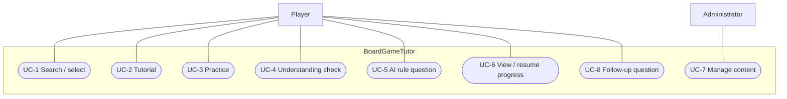
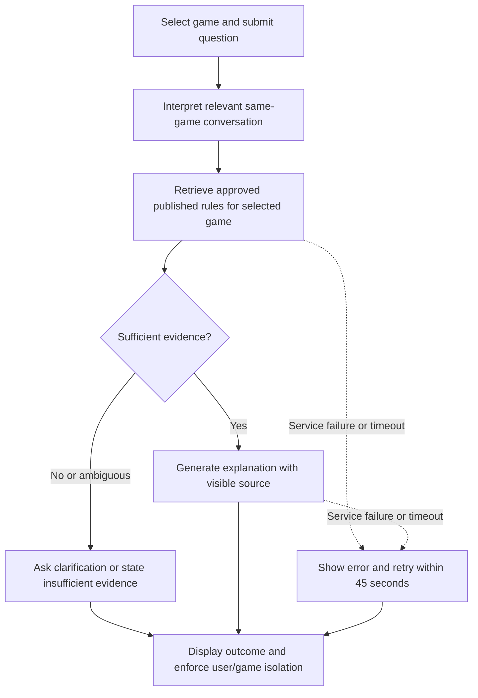

# Software Requirements Specification

### BoardGameTutor - Board Game Learning Assistant

Introduction to Software Engineering (15031001) \| M2 \| Revision 1.3

> Requirements review draft. Uses the Intro2SE StudyMate example for document structure and visual style. BoardGameTutor requirements remain project-specific; stakeholder approval and acceptance tests are pending.

| Field | BoardGameTutor |
| --- | --- |
| Team name | PhomPen Duke (Team 12) |
| Project title | Board Game Tutor |
| SDLC chosen in M1 + reason | Agile: develop in short iterations, obtain player feedback on tutorials and AI explanations, then refine content and requirements. |
| Date / version | 15 November 2026 / v1.3 |
| GitHub repo | https://github.com/6931503111/BoardGameTutor (project reference; implementation compliance is not certified by this SRS). |

## 1. Introduction

### 1.1 Purpose and scope

New and casual board game players may struggle with long rulebooks, repeated video searches and unfamiliar situations. BoardGameTutor combines game discovery, step-by-step tutorials, practice situations, understanding checks and saved progress. An AI Game Rule Assistant retrieves approved rules for the selected game and answers follow-up questions using relevant conversation context.

The MVP covers a limited catalogue of reviewed games. Success targets include 4 of 5 first-time users starting a tutorial within 30 seconds (NFR-2) and passing the defined AI grounding checks (NFR-6). These are proposed acceptance targets. Official rules and administrator review remain authoritative.

### 1.2 Users and stakeholders

| Name / role | Kind | What they need | What they fear / forbid |
| --- | --- | --- | --- |
| New / casual player | Primary user | Find, learn, practise and clarify supported games. | Confusing steps, incorrect rules, lost progress. |
| Game host | Secondary user; Player capabilities | Help a group review rules before playing. | Repeated explanations and unresolved rule disputes. |
| Content administrator | Administrator | Maintain reviewed rules, learning content and sources. | Unreviewed or outdated content being published. |
| Academic evaluator | Assessment stakeholder | Explainable, traceable, testable requirements. | Unverified implementation or testing claims. |

## 2. Overall description

### 2.1 Product context - what it does / does not

BoardGameTutor supports learning and rule clarification. The following list defines the entire MVP for this term.

| IN SCOPE (MVP this term) | OUT OF SCOPE (explicit promise) |
| --- | --- |
| FR-1 Search and select a board game. FR-2 Interactive tutorials. FR-3 Practice game situations. FR-4 Rule understanding checks. FR-5 AI rule questions with KB retrieval. FR-6 Saved learning progress. FR-7 Administrator content management. FR-8 Follow-up questions with context. | Online multiplayer gameplay; buying or selling games; payments or subscriptions; physical rental or delivery; full digital board game recreation; support for every game on the market. |

### 2.2 Assumptions and constraints

**Assumption:** users have a supported browser and network access to the application. The team supplies approved rules and learning material for each supported game.

**Assumption:** persistent progress belongs to an authenticated player; administrator access requires an authorized account. Account provisioning and the supported game list need team confirmation.

**Constraint:** the proposed AI design uses Ollama with retrieval-augmented generation (RAG) over a game-specific knowledge base (KB). Retrieved material must belong to the selected game and approved source set.

**Constraint:** content requires administrator review before publication. Use only material the team may reproduce or reference. No model training or fine-tuning is promised by this SRS.

**Test environment:** record browser, hardware, deployment, model/version, catalogue size, KB versions and network. Use one active test user, a reachable server and a warmed model; report cold starts separately. Numeric targets require team agreement.

### 2.3 Terms and access boundaries

| Term | Meaning / boundary |
| --- | --- |
| Player | Learner using published game content. A game host uses the same capabilities. |
| Administrator | Authorized content reviewer and publisher; server-side role checks are required. |
| KB / RAG | Approved game rule material / retrieval of that material to support an AI answer. |
| Draft / published | Draft is excluded from player views and AI retrieval. Publication applies to a reviewed version. |
| Account access | Sign-in and account provisioning support FR-6 and protected operations; account setup details remain a team decision. |

## 3. Functional requirements

Format: user story, observed or proposed pain, and numbered Given/When/Then acceptance criteria. Pains are retained from the supplied SRS and need real-user validation. All acceptance checks are planned.

### FR-1 - Search and Select a Board Game

**User story:** As a player, I want to search for and select a board game, so that I can find the learning content for the game I want to play.

**Pain this traces to:** Players need to locate the correct supported game before learning its rules.

FR-1.AC1. Given a published catalogue containing a game title, when the player searches for that title or a case-insensitive substring, then matching published games are displayed within the NFR-1 limit.

FR-1.AC2. Given no published title matches the search text, when the search completes, then the system shows a no-results message and does not display an unrelated game as a match.

FR-1.AC3. Given a search result, when the player selects it, then the system displays that game's title and available learning content; unpublished content is not shown.

### FR-2 - Interactive Board Game Tutorial

**User story:** As a new player, I want to learn a board game step by step, so that I can understand the basic rules before playing.

**Pain this traces to:** Players find long rulebooks difficult to understand.

FR-2.AC1. Given a supported game with a published tutorial, when the player starts it, then the first learning step and its position in the sequence are displayed.

FR-2.AC2. Given a learning step, when the player completes it and selects Next, then the next configured step is displayed; after the final step, the tutorial is marked complete.

FR-2.AC3. Given a player is beyond the first step, when they select Previous, then the previous step is displayed without deleting completed progress; saved progress follows FR-6.

### FR-3 - Practice Game Situations

**User story:** As a player, I want to practice with example game situations, so that I can understand how the rules are applied during gameplay.

**Pain this traces to:** Players do not know how rules apply in real situations.

FR-3.AC1. Given a selected game with an approved practice situation, when the player opens it, then the situation description, relevant game state and answer choices are displayed.

FR-3.AC2. Given an unanswered situation, when the player submits a valid choice, then the system compares it with the administrator-approved answer and displays correct/incorrect feedback plus the rule explanation.

FR-3.AC3. Given no answer has been selected, when the player submits, then the system asks them to select an answer and does not record an attempt as correct.

## 3. Functional requirements (continued)

### FR-4 - Rule Understanding Check

**User story:** As a player, I want to check my understanding of the game rules, so that I can identify rules I need to review before playing.

**Pain this traces to:** Players are unsure whether they understand the rules.

FR-4.AC1. Given the player has completed the configured prerequisite tutorial, when they start a check, then the system displays the approved questions for the selected game; if prerequisites are incomplete, it identifies the remaining content.

FR-4.AC2. Given a submitted answer, when it is evaluated, then the result matches the approved answer key; an incorrect answer includes an explanation and a relevant rule reference or tutorial step.

FR-4.AC3. Given all questions have been answered, when the check ends, then the system displays the number correct, total questions and items to review. The result is learning feedback, not a guarantee of gameplay readiness.

### FR-5 - AI Game Rule Assistant

**User story:** As a player, I want to ask about a specific game rule and receive a supported explanation, so that I can resolve a rule question without reading the entire rulebook.

**Pain this traces to:** Players cannot quickly find a specific rule during gameplay.

FR-5.AC1. Given a supported game is selected, when the player submits a non-empty rule question, then the system retrieves approved KB material restricted to that game and uses it as evidence for the answer.

FR-5.AC2. Given sufficient retrieved evidence, when an answer is displayed, then it includes a rule explanation and a visible source label identifying the game/rulebook and section, page or stored rule identifier that supports it.

FR-5.AC3. Given no sufficient evidence, when the system responds, then it states that the available rules do not support a confirmed answer and suggests consulting the official rules; it does not present an invented rule as confirmed.

FR-5.AC4. Given the AI service fails or times out, when the request ends, then the system shows a readable error and retry option within NFR-7's timeout; tutorials and search remain usable.

FR-5.AC5. Given a message requests that the assistant ignore rules or reveal another user's data, when processed, then it does not disclose protected data or change game content; answers remain subject to the same grounding checks.

### FR-6 - Learning Progress Tracking

**User story:** As a player, I want to track my learning progress, so that I know which tutorial steps I have completed and which remain unfinished.

**Pain this traces to:** Players forget where they stopped learning.

FR-6.AC1. Given an authenticated player completes a tutorial step, when saving succeeds, then the system records the player, game and completed step and shows the saved state.

FR-6.AC2. Given saved progress, when the same player leaves, signs in again and reopens that tutorial, then the same completed/incomplete steps are displayed with an option to resume the first incomplete step.

FR-6.AC3. Given another player signs in, when they open the same game, then only their own progress is displayed; if a save fails, the system reports that progress was not saved and offers retry.

## 3. Functional requirements (continued)

### FR-7 - Manage Board Game Content

**User story:** As an administrator, I want to manage board game information and learning content, so that players can access reviewed and updated rules.

**Pain this traces to:** Learning content and source references need maintenance.

FR-7.AC1. Given an authorized administrator, when they save a game with a title, tutorial, practice situation or rule record and its required source reference, then valid data is stored; missing required fields are identified and publication is blocked.

FR-7.AC2. Given new or edited content, when the administrator saves it without publication approval, then it remains a draft unavailable to players and AI retrieval.

FR-7.AC3. Given reviewed content and valid source references, when an authorized administrator publishes it, then the published version is available to players and AI retrieval; the content record identifies the reviewer and reviewed version.

FR-7.AC4. Given an unauthenticated or non-administrator requester, when they attempt a content mutation, then the server rejects it with HTTP 401/403 and the stored content remains unchanged.

### FR-8 - Follow-up Questions and Conversational Context

**User story:** As a player, I want to ask follow-up questions without repeating my original question, so that I can clarify rules through a continuous conversation.

**Pain this traces to:** Players need to clarify an AI answer without repeating the full question.

FR-8.AC1. Given an AI answer in an open game conversation, when the player submits a follow-up referring to it, then relevant earlier messages and the selected game are used to interpret it; newly retrieved evidence remains restricted to that game.

FR-8.AC2. Given an ambiguous reference, when no single intended meaning is clear, then the assistant asks for clarification; if evidence is insufficient, it follows FR-5.AC3.

FR-8.AC3. Given the player changes the selected game or starts a new conversation, when they ask a question, then earlier-game rules are not treated as evidence for the new context. Other users' conversations are never used.

FR-8.AC4. Given a supported follow-up, when the answer appears, then source display and timing follow FR-5.AC2 and NFR-7.

> **Content review rule:** approval applies to a specific version. Editing published rules creates a draft for renewed review. The last approved version remains authoritative until the revision is published. This intended workflow must be checked against implementation.

## 4. Non-functional requirements

Every threshold below is a proposed acceptance target for the environment in Section 2.2. Security/privacy is included as required by the Intro2SE example. No pass results are claimed.

| ID / kind | Statement (testable) | How we will check |
| --- | --- | --- |
| NFR-1 Performance | At least 19 of 20 searches display results or a no-results state within 2 seconds, from submission until visible results. | T-01: 10 matching and 10 non-matching searches; record client times and catalogue size. At least 19 meet 2 s. |
| NFR-2 Usability | At least 4 of 5 first-time users start the first step of a named supported tutorial within 30 seconds from the home page, without help. | T-02: same task for 5 first-time users; record time, completion and assistance. |
| NFR-3 Reliability | In 10 save/leave/reopen trials, 100% of successfully saved tutorial completions remain linked to the same player and game after sign-out/sign-in. Failed saves are never labelled saved. | T-06: two accounts, at least two games, 10 restoration trials; force a failed save and inspect feedback. |
| NFR-4 Security / privacy | Every protected request checks identity and authorization server-side. Zero unauthorized reads or writes succeed across the defined tests. Only administrators mutate game content. | T-09: anonymous, cross-account progress/conversation access and player-to-admin mutation attempts. Require 401/403 or non-disclosing 404; no protected data or state change. |
| NFR-5 Content accuracy | 100% of published or retrieved content has an approved version, an identified reviewer and a source reference. Draft/unapproved content is excluded. | T-07: create draft, review, publish, then edit. Inspect public/retrieval visibility and the reviewer/version record. |

### Security and evidence boundaries

Approved public rules may be read by players. Account data, progress and conversations are owner-scoped. Test direct server/API requests as well as UI visibility: hiding a button does not satisfy authorization.

Password storage, session expiry, retention and production transport settings were not established by the supplied SRS. Confirm them against the deployment plan. A content approval record is a control, not proof that every AI answer is correct.

## 4. Non-functional requirements (continued)

| ID / kind | Statement (testable) | How we will check |
| --- | --- | --- |
| NFR-6 AI response reliability | Fixed 30-case suite: at least 18 of 20 answerable questions are correct and supported by approved rules; all 20 cite an existing relevant source. All 5 unsupported questions state insufficient evidence; all 5 ambiguous follow-ups request clarification. Zero answers confirm a rule contradicted by the approved source. | T-05 / T-08: 20 answerable questions (including 5 follow-ups), 5 unsupported and 5 ambiguous questions. Administrator reviews expected outcomes; record question, game, source, response and judgement. Re-run after model, prompt or KB changes. |
| NFR-7 AI response time / failures | In the warmed environment, at least 27 of 30 requests reach a complete answer, clarification or limitation within 30 seconds. Failed/hanging requests show readable error and retry within 45 seconds. Failure messages do not count as successful answers. | T-10: measure submission to full visible response; record hardware, model, KB, failures, p90 and cold starts separately. Stop AI service and simulate a hang; confirm 45 s bound and usable search/tutorials. |

### 4.1 Acceptance evidence record

All T-01 to T-10 tests are **not run in this document revision**. Use the following record when executing each test; retain failures rather than reporting targets as results.

| Evidence field | Required record |
| --- | --- |
| Test / requirement | Test ID; FR and AC IDs; related NFR; tester and date. |
| Environment | Browser, client/server hardware, deployment, model/version, game and KB/content version; warm/cold state. |
| Input / expected | Exact action or question; account/role; approved expected result and source. |
| Actual / decision | Observed output, timing, pass/fail, screenshot or log reference; defect and retest reference when applicable. |

> A passing fixed suite demonstrates the tested cases only. Team approval of targets, stakeholder validation and actual execution remain necessary before claiming compliance.

## 5. Use cases

### 5.1 Use-case list

| Use case | Actor | Related FR | Brief success story |
| --- | --- | --- | --- |
| UC-1 Search / select | Player | FR-1 | Find a published title and open its learning page. |
| UC-2 Tutorial | Player | FR-2 | Complete steps and review an earlier step. |
| UC-3 Practice | Player | FR-3 | Answer a situation and receive approved feedback. |
| UC-4 Understanding check | Player | FR-4 | Complete a check and identify items to review. |
| UC-5 AI rule question | Player | FR-5 | Receive a supported explanation and source. |
| UC-6 View / resume progress | Player | FR-6 | Return and resume unfinished learning. |
| UC-7 Manage content | Administrator | FR-7 | Review and publish a source-linked version. |
| UC-8 Follow-up question | Player | FR-8 | Clarify an earlier answer within the selected game. |

### 5.2 Use-case diagram

Figure 1. Eight use cases inside the BoardGameTutor system boundary. Lines show actor associations. The game host uses Player capabilities. Authentication is a precondition for private progress and administration. No mandatory <<include>> or <<extend>> relationship is asserted between complete use cases.

## 5. Use cases (continued)

### 5.3 Detailed use case - UC-8 Ask a follow-up

| Field | Specification |
| --- | --- |
| Primary actor | Player. |
| Preconditions | Supported game selected; an open AI conversation contains an earlier answer. |
| Trigger | Player submits a follow-up referring to the earlier exchange. |
| Main success flow | 1. Accept a non-empty follow-up. 2. Identify selected game and relevant earlier messages. 3. Retrieve approved supporting rules for that game. 4. Generate explanation with a visible source reference. 5. Display answer; player may continue the conversation. |
| Alternative flows | A1 Ambiguous reference: ask clarification. A2 Insufficient evidence: state limitation; do not confirm unsupported rules. A3 Failure/timeout: readable error and retry within NFR-7. A4 Game change/new conversation: establish new context; exclude prior-game evidence. |
| Postconditions | Answer, clarification, limitation or failure is visible; game and user privacy boundaries remain enforced. |
| Links | FR-8; FR-5.AC2-4; NFR-4, NFR-6, NFR-7; T-05, T-08, T-09, T-10. |

### 5.4 AI question and follow-up activity diagram

Figure 2. Intended question-processing activity, shared by FR-5 and FR-8. Dashed branch represents service failure/timeout at AI processing stages. The diagram describes required behaviour; it is not implementation evidence.

## 6. Out of scope

1. Online multiplayer board game gameplay. 2. Buying and selling board games. 3. Payments and subscriptions. 4. Physical board game rental. 5. Delivery services. 6. Full digital recreation of physical board games. 7. Supporting every board game on the market.

The AI explains approved rules; it does not execute a complete digital game or replace official rules. These limits match Section 2.1.

## 7. Traceability matrix (Golden Thread)

The five columns follow the Intro2SE example. Design and feature entries below are intended requirements-level solutions. Feature-built status is unverified; tests are planned.

| Problem / pain | FR / NFR | Solution / design | Feature built | Test |
| --- | --- | --- | --- | --- |
| Cannot locate a supported game. | FR-1; NFR-1 | Published catalogue search; UC-1. | Search and game page. Not verified. | T-01: AC1-3; matching/no-match, selection, draft exclusion; 19/20 within 2 s. |
| Long rulebooks are hard to learn. | FR-2; NFR-2 | Sequenced tutorial; UC-2. | Previous/Next and completion. Not verified. | T-02: ordered steps and completion; 4/5 new users start within 30 s. |
| Hard to apply rules to situations. | FR-3 | Approved situations and answer key; UC-3. | Practice feedback. Not verified. | T-03: correct, incorrect and empty submission; approved explanation. |
| Unsure what rules are understood. | FR-4 | Prerequisite gate and check; UC-4. | Score and review list. Not verified. | T-04: prerequisite, answer marking, explanation and correct/total count. |
| Specific rules are hard to find. | FR-5; NFR-6 | Game-scoped RAG with sources; UC-5. | Rule question assistant. Not verified. | T-05: retrieval, citations, unsupported/attack cases; 30-case rubric. |
| Forget learning position. | FR-6; NFR-3 | Player/game step records; UC-6. | Saved progress and resume. Not verified. | T-06: 10 restorations, failed-save feedback; no owner/game mix-ups. |
| Content becomes outdated or unreviewed. | FR-7; NFR-5 | Versioned review/publication; UC-7. | Draft and publish controls. Not verified. | T-07: required fields, draft exclusion, source/reviewer/version, renewed review. |
| Need clarification without repeating. | FR-8; NFR-6 | Relevant conversation plus game-scoped evidence; UC-8. | Follow-up conversation. Not verified. | T-08: resolved/ambiguous reference, new chat and game switch. |

## 7. Traceability matrix (continued)

| Problem / pain | FR / NFR | Solution / design | Feature built | Test |
| --- | --- | --- | --- | --- |
| Private learning data or content accessed without permission. | NFR-4; FR-7.AC4; FR-8.AC3 | Server-side identity, owner and administrator checks. | Protected API access. Not verified. | T-09: anonymous, cross-account and non-admin requests reveal no private data and cause no unauthorized change. |
| AI is slow or unavailable. | NFR-7; FR-5.AC4 | Bounded request, readable error and retry. | AI failure handling. Not verified. | T-10: 27/30 complete within 30 s; error/retry within 45 s; search/tutorial remain usable. |

## 8. AI usage log

Historical entries are carried forward as team-reported records. No stakeholder interview, code compliance audit or acceptance test was performed during this document revision.

| Date / tool | What we asked | What AI produced | What changed / verified | What we learned |
| --- | --- | --- | --- | --- |
| 29 Aug 2026 Claude (reported) | Brainstorm features and user narratives for board game learning. | Learning steps, lesson ideas and rule Q&A stories. | Prior log reports role/goal/benefit and AC edits; team confirmation pending. | AI drafts need measurable criteria. Historical record unverified. |
| 15 Nov 2026 ChatGPT / Codex (prior v1.2 log) | Compare Team12 SRS against M2-srs. | Numbered ACs, measurable NFRs, use cases, traceability and review status. | Document comparison only; no implementation or runtime certification. | Reference structure does not transfer another project's evidence. |
| 15 Nov 2026 ChatGPT / Codex (v1.3) | Use Intro2SE as example; add diagrams/missing items and match its design. | Reformatted SRS, use-case/activity diagrams, five-column Golden Thread, terms and evidence record. | Compared both supplied PDFs; retained FR-1 to FR-8 and ACs; checked generated layout and mappings. Team review pending. | Diagrams and design must match the same requirements; intended features are not proven implementation. |

### 8.1 AI used in the product

The proposed product uses Ollama with RAG over an approved game-specific KB. FR-5 covers grounding, sources and failures; FR-8 covers context. The supplied SRS does not establish the deployed model, retrieval configuration or measured performance. Verify these before submission or demonstration.

## 9. Self-check

- [x] All eight FRs have a role, goal and explicit benefit.

- [x] Every FR has numbered Given/When/Then acceptance criteria.

- [x] NFRs include security/privacy and measurable acceptance targets.

- [x] UC-1 to UC-8 match FR-1 to FR-8; actor associations are shown.

- [x] Detailed UC-8 alternatives and an AI activity diagram are included.

- [x] Scope and out-of-scope are consistent in Sections 2.1 and 6.

- [x] Five-column Golden Thread maps all FRs and NFRs to planned tests.

- [x] AI use for this revision is recorded without inventing human approval.

- [ ] Team approved thresholds and recorded deployment/test conditions.

- [ ] Problem statements and requirements validated with real stakeholders.

- [ ] Supported games, account provisioning and review workflow confirmed.

- [ ] Acceptance tests executed with dated evidence; implementation checked.

- [ ] Team confirmed historical AI log and can explain each FR orally.

> Submission status: revised requirements draft. Checked document structure and layout do not mean that stakeholder validation, implementation or acceptance testing has passed.

